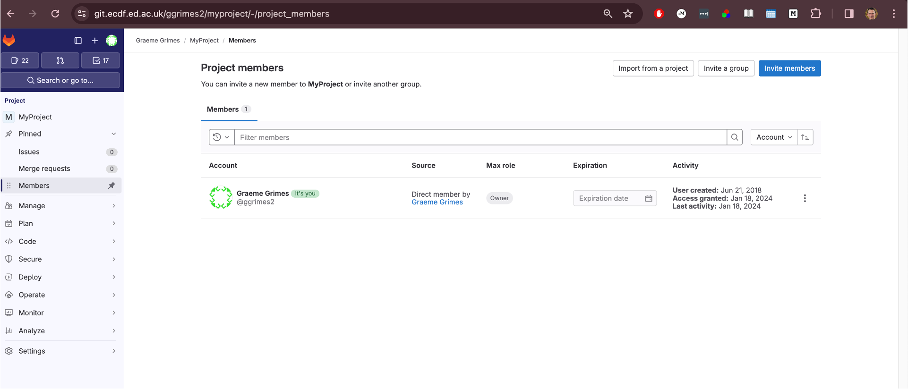
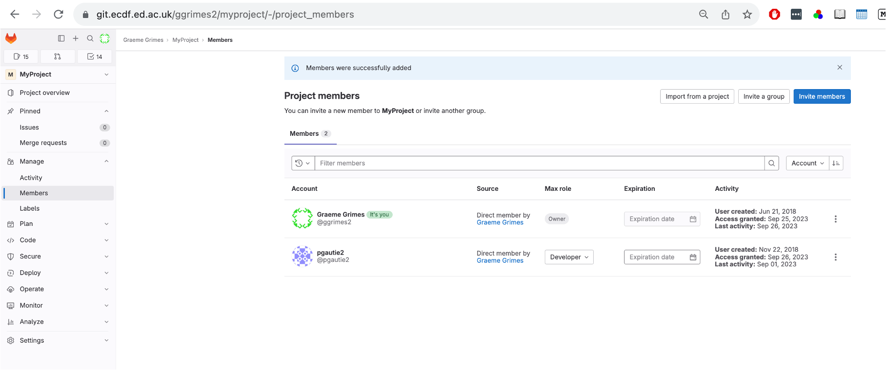
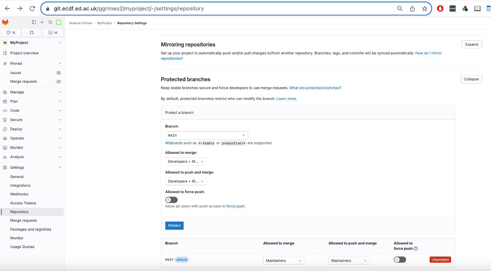
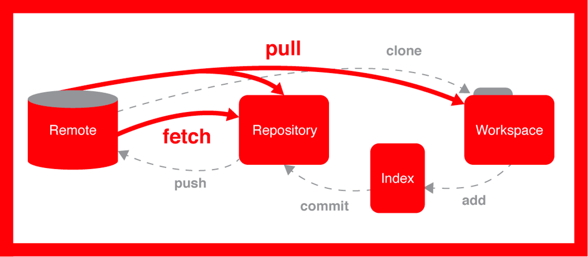
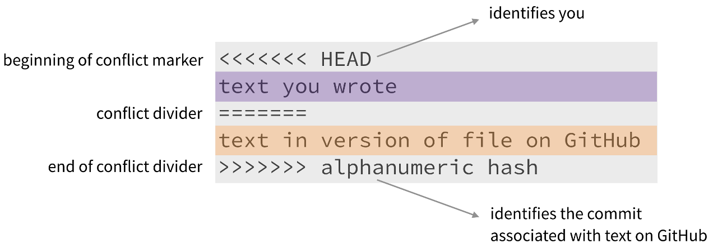

::: questions
-   How do I collaborate with others using Git?
-   What different models exist for Git collaboration?
-   What are protected branches, and how do I handle merge conflicts?
:::

::: objectives
-   Describe multiple models of collaboration using Git
-   Demonstrate how to add collaborators and manage permissions in GitLab
-   Practice cloning, committing, and pushing to a shared repository
-   Resolve a rejected push and a simple merge conflict
:::

## Collaborating with Git

One of Git's most powerful features is that it makes collaboration straightforward and trackable. When working with others, a shared repository acts as the single source of truth. Contributors clone, modify, and then sync their work using version control commands like `pull`, `commit`, and `push`.

## Different Models for Collaboration

There are several ways to collaborate using Git:

-   **Shared repository model**: You give collaborators direct access to your repository. This is quick but requires trust.

-   **Fork-and-pull model**: A collaborator creates a copy (fork) of your repository, makes changes, and submits a *merge request* (also called a pull request). This is commonly used in open-source projects. It may not work between two private repositories.

::::::::::::::::::::::::::::::::::::: challenge

## Which model?

For each situation, would you choose the shared repository model or the
fork-and-pull model?

1. You and a colleague in the same research group are writing analysis
   scripts for a joint paper.
2. You want to suggest a fix to a public R package maintained by people you
   have never met.
3. A new student joins your lab and you want to review their changes before
   they reach `main`.

:::::::::::::::: solution

1. **Shared repository.** You know and trust each other, and you both need to
   push changes regularly.
2. **Fork and pull.** You don't have permission to push to their repository,
   so you work in your own fork and open a merge request.
3. **Either can work.** A shared repository with a protected `main` branch,
   where the student works on a branch and opens a merge request, gives you
   the chance to review. Forking also works if you'd rather not give them
   write access.

:::::::::::::::::::::::::

:::::::::::::::::::::::::::::::::::::::::::::::

For this exercise, we assume a **shared repository trust model**. That means you'll work directly in each other's repositories.

We’ll now walk through the process of adding a collaborator and working on the same project together.

## Step 1: Pair Up and Add a Collaborator

You will work in pairs. First:

-   Introduce yourselves.
-   Person 1: Get the UUN (University User Name) of Person 2.

### Add Member to Your Repository

**Person 1** should add **Person 2** as a collaborator on their GitLab repository:

1.  Go to the sidebar and click `Project → Members`.
2.  Click **Invite members**.
3.  Enter Person 2's UUN.
4.  Set the role to **Developer**.
5.  Confirm the role is set correctly in the members list.

{alt="GitLab Project members page for MyProject with the Invite members button at the top right."}

{alt="GitLab Project members page after a collaborator has been added with the Developer role, alongside the Owner."}

## Step 2: Unprotect the Branch

In GitLab, branches can be protected to restrict who can push to them. To allow collaborators to push changes, you need to modify this setting:

-   Go to `Settings -> Repository -> Protected Branches`.
-   Find the `main` branch (or `master` depending on your setup).
-   Click **Unprotect**.

{alt="GitLab Repository settings, Protected branches section, showing the main branch with a red Unprotect button."}

## Step 3: Clone the Repository

What if you were given a link to a folder from a remote location that you needed to get on your computer? How would you do that? You’d need to make a copy of the remote repository to your local machine. In the world of Git, this is referred to as “cloning.” The command for cloning is, you guessed it, `git clone`.


**Person 2** now clones the repository on their system (e.g., on Eddie):

``` bash
git clone https://git.ecdf.ed.ac.uk/<person1>/myproject.git project-collab
cd project-collab
git remote -v
```

This creates a local copy of the repository and shows the remote repository settings.

{alt="Diagram of a remote, local repository, index and workspace: clone copies the remote to the workspace, fetch brings changes into the local repository, pull brings them into the workspace, and add, commit and push send changes back."}

## Step 4: Check Who Edited What

Git provides the `blame` command to show who last modified each line of a file:

``` bash
git blame README.md
```

This is useful when debugging or understanding the origin of changes.

## Step 5: Make a Change and Commit

**Person 2** can now make a change to the `README.md` file:

``` bash
nano README.md  # or use any editor
```

After saving the file:

``` bash
git add README.md
git commit -m "Update README.md with message from Person 2"
```

## Step 6: Push the Changes

Now attempt to push:

``` bash
git push
```

::: callout
### Rejected?

If you see a "rejected" message, this likely means your local copy is behind the remote. You need to pull the latest changes:

``` bash
git pull
```

Then resolve any conflicts if necessary and try pushing again.
:::

::::::::::::::::::::::::::::::::::::: challenge

## Why was my push rejected?

Person 1 and Person 2 both cloned the repository at the same commit. Person 1
edits `Src/hello.py`, commits and pushes. Person 2 then edits `README.md`,
commits and runs `git push`.

1. What happens when Person 2 pushes?
2. What should Person 2 do next?
3. Will there be a merge conflict?

:::::::::::::::: solution

1. The push is **rejected**. The remote now has a commit (Person 1's) that
   Person 2 doesn't have locally, so Git refuses to overwrite it.
2. Run `git pull` to fetch and merge Person 1's commit, then `git push` again.
3. **No.** The two people changed different files, so Git can merge the
   changes automatically. A conflict only happens when both people change the
   same lines of the same file.

:::::::::::::::::::::::::

:::::::::::::::::::::::::::::::::::::::::::::::

## Merge Conflicts

Sometimes two collaborators edit the same part of a file. This creates a *merge conflict*.

Git will mark the conflict like this:

{alt="Merge conflict markers: <<<<<<< HEAD marks the start and your text, ======= divides it from the other version, and >>>>>>> followed by a commit hash marks the end."}

You must manually edit the file to resolve the conflict, then:

``` bash
git add filename
git commit -m "Resolve conflict in filename"
git push
```

::::::::::::::::::::::::::::::::::::: challenge

## Create and resolve a conflict

Working with your partner in the shared repository:

1. Both of you run `git pull` so you start from the same commit.
2. Both of you edit the **same line** of `README.md`, for example the title,
   and write something different.
3. Person 1 commits and pushes first.
4. Person 2 commits, then tries to push. When the push is rejected, run
   `git pull`.
5. Person 2 opens `README.md`, resolves the conflict, then adds, commits and
   pushes.
6. Person 1 runs `git pull` and checks that the resolved version has arrived.

Finally, run `git log --oneline --graph` and find the merge commit.

:::::::::::::::: solution

After step 4, Person 2 sees a message like this:

```output
CONFLICT (content): Merge conflict in README.md
Automatic merge failed; fix conflicts and then commit the result.
```

`README.md` now contains both versions between the `<<<<<<<`, `=======` and
`>>>>>>>` markers. To resolve it, Person 2 edits the file to keep the text
they want (one version, the other, or a mix of both) and **deletes all three
marker lines**. Then:

```bash
git add README.md
git commit -m "Resolve conflict in README title"
git push
```

In `git log --oneline --graph`, the merge commit is where the two lines of
history join.

:::::::::::::::::::::::::

:::::::::::::::::::::::::::::::::::::::::::::::

::: callout
## Optional: Cache Your Credentials

If you're prompted for your credentials too often, you can cache them temporarily:

``` bash
git config --global credential.helper 'cache --timeout=3600'
```

This caches your credentials for one hour.
:::

::: keypoints
-   Git allows multiple collaboration models; shared access is fastest but requires trust.
-   GitLab permissions and protected branches must be configured for collaborators.
-   Always pull before pushing to avoid rejection.
-   Merge conflicts are normal and can be resolved with manual editing.
:::
